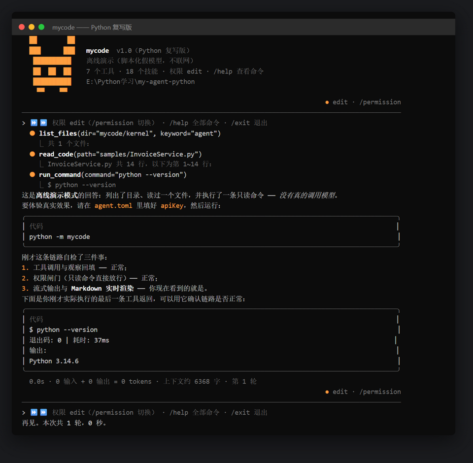

# mycode（Python 复写版）



一个**从零手写**的命令行 AI 编程助手，是同名 Java 项目（`E:\javaagent`）的 Python 复写版。
除 Python 标准库外**零第三方依赖**（Java 版除 JSON 序列化外零框架依赖；
Python 连 JSON 都是内置的，做到了真正的零依赖），目的是让人看清一个 agent
到底由哪些零件组成，而不是再学一套框架 API。

```text
 你（终端 / 桌面窗口）
   │ 提问 / 斜杠命令
   ▼
 Shell 或 DesktopApp ──会话──► Agent（ReAct 主循环）
                   │  ① 组装上下文（历史 + 工具说明，超长自动压缩）
                   │  ② 调用模型（OpenAI 兼容 / Anthropic 双协议）
                   │  ③ 模型点名工具 → ToolRegistry 分发执行
                   │  ④ 结果回填，循环直到模型给出最终回答
                   ▼
      工具集：联网搜索 / 改代码 / 跑命令 / 待办清单 …（MCP / 技能 / 子代理 二期）
```

## 快速开始

环境要求：**Python 3.11+**（零第三方依赖，无需 pip install）。

```bash
# 1. 配置模型
cp agent.example.toml agent.toml
#    编辑 agent.toml：填 provider / baseUrl / apiKey / model（键名与 Java 版一致）

# 2. 运行
python -m mycode                      # 交互模式（Windows 也可用 mycode.bat）
python -m mycode "看看 Agent 的主循环"  # 单次提问
python -m mycode --demo               # 交互式离线演示：假模型跑完整工具链，不联网不花钱
python -m mycode --help               # 全部命令

# 桌面版（tkinter 图形界面，Windows 也可用 mycode-desktop.bat）
python -m desktop                     # 同一套配置与参数
python -m desktop --demo              # 离线演示版
python -m desktop --continue          # 恢复最近一次会话（与终端版存档互通）
```

### 演示与调试入口

| 命令 | 作用 |
| --- | --- |
| `--mock` | 门票演示：查景点 → 查天气 → 算门票，离线假模型跑完整 ReAct 循环 |
| `--demo` | 交互模式 + 离线假模型：列目录 → 读文件 → 跑只读命令 |
| `--code-demo` | 代码编辑演示：读文件 → 替换 → 语法校验 → 出差异 |
| `--dump` | 打印 OpenAI 与 Anthropic 两种协议的真实报文 |
| `--config` | 查看当前生效的模型配置（不发请求） |

## 交互命令

```text
/help  /clear  /lang      帮助、清空上下文、切换回答语言（中/英）
/tools /files /skills     查看已加载的工具、项目文件、技能
/model /permission /cost  当前模型、权限模式、token 与费用统计
/compress /undo /history  手动压缩上下文、回滚修改、回看修改快照
/exit                     退出（/quit /q 同义）
```

（桌面版斜杠命令清单与终端版逐条对齐，输出落到聊天区。）

## 桌面版（tkinter）

`desktop/` 是与 `shell/` 平级的第二种「脸面」：kernel / clients / tools / extensions
四层一行不改完全复用，只把「终端绘制 + input() + 按键确认」换成 Tk 控件 +
输入框 + 模态对话框。启动参数与终端版一致（`--demo --continue --lang= --permission=
--provider= ...`），会话存档与终端版互通（同一个 `.mycode/sessions/`）。

| 文件 | 职责 |
| --- | --- |
| `theme.py` | 配色 / 字体 / Tk tag 常量（终端 ANSI 配色的 GUI 对照表） |
| `render.py` | Tk 版 Markdown 渲染（与 shell/markdown.py 同一套语法，目标是 tag 区间而非 ANSI 字符串） |
| `hook.py` | `GuiHook`：六类钩子事件 → 格式化文本行；`PlainPresenter`：TodoTool 的界面能力等价物 |
| `bridge.py` | 线程桥：worker 线程跑 `ChatSession.ask`，事件队列连回主线程，权限确认跨线程等待 |
| `runtime.py` | 装配（对照 shell.Shell 的装配段）：模型 / 工具 / 权限 / 技能 / --continue |
| `commands.py` | 斜杠命令分发（对齐终端版清单，含 difflib 未知命令建议） |
| `app.py` | 主窗口：对话区 / 输入区 / 状态栏 + 事件分发主循环 + 流式块节流重渲染 |

线程模型（内核是纯同步阻塞代码，Tk 只允许主线程碰控件）：

```text
worker 线程 ─ ask() 流式增量 / 钩子事件 / 裸 print ─► 事件队列
主线程 root.after(50ms) 轮询队列 ─► 控件更新 / 模态权限对话框
权限确认：worker 阻塞等 Event，主线程弹框回填三态（allow / always / deny）
```

两个刻意的取舍：worker 期间用 `redirect_stdout` 把 kernel/tools 里散落的裸 print
逐行捕获成聊天区输出（一处兜住所有不走界面的漏点）；内核没有协作式取消，
所以桌面版也没有「停止」按钮（与终端版对等，二期给内核加取消后再补）。

密钥体验：启动时检测到未配置 `apiKey` 会自动弹窗收集（回车确定 / Esc 跳过），
勾选「保存到 agent.toml」则写入配置文件（行级替换，保留注释），下次不再询问；
`--demo` 离线演示与 ollama / custom 本地服务不弹窗。

定时任务：与终端版完全对齐——对模型说「10 分钟后提醒我…」它会调 `schedule` 工具
（scope=session 走会话调度器，退出失效；scope=persistent 写入 `.mycode/schedules.json`），
到点在后台以独立上下文执行，结果作为 ⏰ 事件渲染进聊天区；启动时提示未读报告，
`/schedules` 查看与管理、`/reports` 查看 Markdown 报告。

## 配置

配置文件为项目根目录的 `agent.toml`（模板见 `agent.example.toml`，键名与 Java 版
`agent.properties` 完全一致）。优先级：**命令行参数 > 环境变量 > 配置文件 > 内置预设**。
支持的服务商预设：`dashscope / openai / deepseek / moonshot / zhipu / ollama / anthropic / custom`。
联网搜索为可选功能：配置环境变量 `BOCHA_API_KEY` 或 `TAVILY_API_KEY` 后自动挂载 `web_search`。

## Java ↔ Python 模块对照表

`mycode/` 按「内核 → 客户端 → 工具 → 外围」分层，每个文件的模块 docstring
都写清了它在整体中的位置。下层禁止 import 上层。

| 分层 | Java 版 | Python 版 | 说明 |
| --- | --- | --- | --- |
| 数据 | `ToolCall` `ChatResult` `Usage` | `kernel/types.py` | 全项目唯一数据定义处 |
| 接口 | `Tool` `SimpleTool` | `kernel/tool.py` | `execute()` 改名 `run()`（Python 惯例） |
| 接口 | `LlmClient` `StreamSink` | `kernel/llm.py` | 端口上移到内核（Agent 依赖它，分层要求） |
| 容器 | `ToolRegistry` | `kernel/registry.py` | 安全分发，异常转 ERROR 观察 |
| 上下文 | `AgentContext` | `kernel/context.py` | OpenAI 协议消息数组 + 摘要管理 |
| 会话 | `ChatSession` | `kernel/session.py` | 独立成文件避免循环导入 |
| 压缩 | `ContextCompressor` | `kernel/compressor.py` | 整轮摘除 → 模型摘要 → 覆盖写回 system |
| 主循环 | `Agent` | `kernel/agent.py` | ReAct for 循环：审批串行 → 执行并行 → 回填串行 |
| 钩子 | `Hook` `ConsoleHook` `LoggingHook` | `kernel/hooks.py` | 界面对象依赖注入，内核不 import 外围 |
| 权限 | `PermissionMode` `PermissionHook` | `kernel/permission.py` | `CommandPolicy` 并入本文件（纯决策逻辑归内核） |
| 重试 | `Retries` | `kernel/retries.py` | 指数退避；同样上移到内核层 |
| 客户端 | `OpenAiCompatibleClient` | `clients/openai_client.py` | 流式 SSE + 重试安全的 stream_options 兜底 |
| 客户端 | `AnthropicClient` | `clients/anthropic_client.py` | 六处协议差异转换 + 相邻同角色合并 |
| 工厂 | `LlmFactory` | `clients/factory.py` | 八家预设 + baseUrl 归一化 + key 打码 |
| 解析 | `SseAccumulator` `Args` | `clients/sse.py` | 工具参数解析公共件 |
| HTTP | `java.net.http.HttpClient` | `clients/net.py` | 标准库 http.client 直连 |
| 演示 | `ScriptedLlmClient` | `clients/scripted.py` | 离线假模型，先验证控制流再接真模型 |
| 协议对照 | `RequestDump` | `clients/dump.py` | `--dump`：同一对话渲染成两种报文 |
| 工具 | `CommandTool` | `tools/command.py` | 超时强杀 + GBK 解码 + 后台任务 |
| 工具 | `CodeFile` | `tools/code_file.py` | 保住编码 / 换行 / BOM |
| 工具 | `CodeTools` | `tools/code_tools.py` | list_files / read_code |
| 工具 | `CodeEditor` | `tools/code_editor.py` | 纯函数文本变换 + LCS 差异统计 |
| 工具 | `CodeEditTool` | `tools/code_edit.py` | 落盘 + ast 校验 + 自动回滚 + verifyCommand |
| 工具 | `JavaSyntaxCheck` | `tools/syntax_check.py` | 改校验 .py（ast），其余文件括号平衡 |
| 工具 | `WebSearchTool` + 四个 Provider | `tools/web_search.py` | Tavily / 博查 / 离线模拟 + LRU 缓存 |
| 工具 | `TodoTool` | `tools/todo.py` | 可视化任务清单 |
| 工具 | `BackupStore` | `tools/backup.py` | 每文件 20 版快照，支撑 /undo /history |
| 外围 | `Ui` | `shell/ui.py` | CJK 对齐 + 分隔线输入区 + 转圈 + 选项确认 |
| 外围 | （Java 版无，Python 版新增） | `shell/markdown.py` | 终端 Markdown 渲染 + 流式原地重绘 |
| 外围 | `Costs` | `shell/costs.py` | 两档缓存价折算 |
| 外围 | `Language` | `shell/language.py` | 回答语言约束拼进 system |
| 外围 | `SessionStore` | `shell/session_store.py` | JSONL 存档 + --continue 恢复 |
| 外围 | `Shell` | `shell/shell.py` | REPL + 斜杠命令 + 装配 |
| 扩展 | `Frontmatter` | `extensions/frontmatter.py` | SKILL.md frontmatter 解析（零 YAML 依赖） |
| 扩展 | `Skill` / `SkillRegistry` / `SkillTool` | `extensions/skills.py` | Agent Skills：四级目录扫描 + use_skill 渐进加载 |
| 入口 | `Main` | `__main__.py` + `demo.py` | 只做分发；演示装配在 demo.py |
| 配置 | `AgentConfig` | `config.py` | agent.properties → agent.toml（tomllib） |

**已接入扩展**：Agent Skills（`extensions/frontmatter.py` + `extensions/skills.py`）——
直接兼容 Claude Code 的技能目录（`.mycode/skills/`、`.claude/skills/`、`~/.claude/skills/`），
`/skills` 查看、`use_skill` 渐进加载；仓库自带内置演示技能 `skills/hello-mycode/`；
`agent.toml` 里 `skills = ["docx", "xlsx"]` 可做白名单过滤。
定时任务（`extensions/scheduler.py` + `cron.py`）—— 会话内任务对模型说「10 分钟后提醒我…」
即可（`schedule` 工具创建，退出失效）；持久化任务 scope=persistent 写入
`.mycode/schedules.json`（跨会话），`python -m mycode --cron` 无头执行、
`--cron-register` 注册 Windows 计划任务，报告落盘 `.mycode/schedules/`，
`/schedules` 管理（cancel/pause/resume/delete）、`/reports` 查看；
无人值守默认 read-only，需人工确认的命令一律拒绝，报告只落盘不外发。

**二期占位**（Java 版已有、本版未接入）：`McpClient`/`McpTool`（MCP 外部工具）、
`AgentRegistry`/`AgentDefinition`/`SubAgentTool`/`TaskOutputTool`（子代理）、
`FetchPageTool`（抓网页）、`RepoMapTool`（仓库地图）、`ProjectMemory`（项目记忆）、
`Calculator`。相应斜杠命令 `/agents /memory` 目前给出二期提示。

## 复写时的刻意调整

| 调整 | 原因 |
| --- | --- |
| `Tool.execute()` → `run()` | 避开 `cursor.execute()` 这一数据库惯用名的扫描误报，且更 Pythonic |
| HTTP 用 `http.client` 直连（`clients/net.py`） | 对应 Java 版 `HttpClient`（连接超时/复用语义一致），统一 URL 校验入口 |
| 变量路径写盘一律 pathlib（`.write_bytes()` 等） | 语义更清晰，且避开「内置 open 可写模式」的路径穿越误报 |
| 终端宽度用 `shutil.get_terminal_size()` | JDK 拿不到控制台宽度才需要 DSR 探测泵；Python 标准库一步到位，整套 stdin 泵不再需要 |
| `agent.properties` → `agent.toml` | 3.11+ 标准库自带 tomllib；键名保持一致，两边可对照学习 |
| 终端渲染对象依赖注入 | kernel 层的 ConsoleHook/TodoTool 需要 UI 能力，但内核禁止 import 外围 |
| `_system_prompt` → `system_prompt(surface)`、`_env_block` → `env_block`（shell.py） | 终端与桌面两个前端共用一份 system 提示词（单一来源）；surface 参数只改「终端 / 桌面窗口」两处措辞 |

## 设计原则（与 Java 版一致）

1. **零第三方依赖**：只用标准库，每个零件都能独立读懂
2. **内核不绑定协议**：内核层看不到 OpenAI / Anthropic 的类型，换模型供应商只动客户端层
3. **工具说明即提示词**：工具的 `description()` 直接决定模型调用准确率
4. **安全默认**：命令执行三道保险（策略/审批/超时），代码修改自动备份可回滚，密钥文件永远不进 git

## 作者

本项目由 **my** 与 AI 助手共同完成：人负责选题、架构设计与每一步取舍，
AI 负责把想法落成代码与中文注释。原 Java 版见 `E:\javaagent`（MIT License）。
